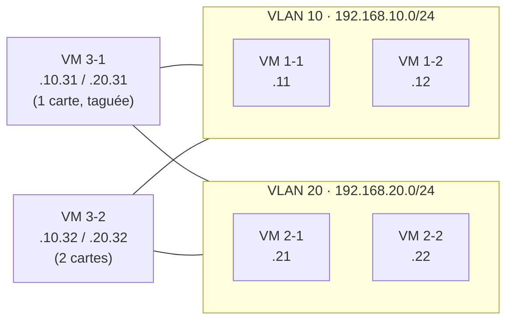
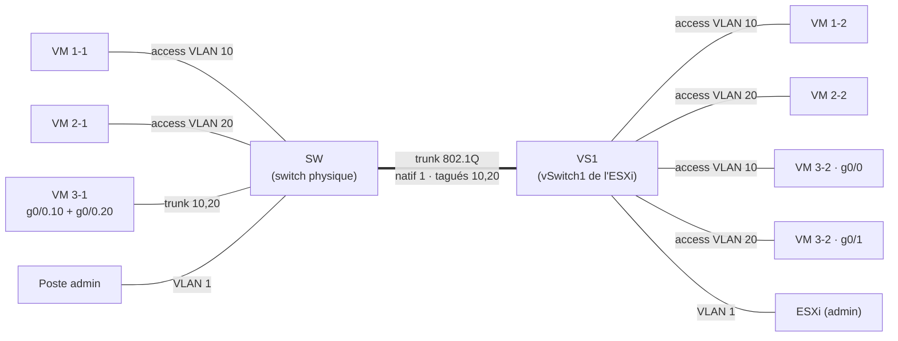

# Mise en place des VLANs et du tagging 802.1Q


Segmentation d'un réseau en deux VLANs isolés, avec des liens tagués 802.1Q entre un switch physique et une infrastructure virtualisée (ESXi), simulée dans **Cisco Packet Tracer**.

Projet réalisé dans le cadre du TP « Mise en œuvre des VLANs » à **JUNIA ISEN**, en préparation de la séance sur matériel réel (switch + serveur VMware ESXi).

> **English summary:** two isolated VLANs (10 and 20) carried over a single 802.1Q trunk between a physical switch and an ESXi vSwitch, simulated in Cisco Packet Tracer. Includes full IOS configs, a one-NIC host tagging both VLANs, test evidence and troubleshooting notes.


---

## Objectif

- Séparer six machines en **deux réseaux logiques isolés au niveau 2** (VLAN 10 et VLAN 20).
- Permettre à deux machines d'appartenir **aux deux réseaux à la fois** :
  - **VM 3-1**, avec **une seule carte réseau** : elle doit taguer elle-même ses trames (802.1Q) ;
  - **VM 3-2**, avec **deux cartes réseau** : une carte par VLAN, sans tag.
- Faire transiter les deux VLANs, plus le réseau d'administration, sur **un seul câble** entre le switch et l'ESXi (trunk 802.1Q avec VLAN natif).
- Vérifier que les deux VLANs ne communiquent pas, et préparer le test qui prouve l'isolation au niveau 2 (voir [Limite du test d'isolation](#limite-du-test-disolation)).

## Compétences mobilisées

`VLAN` · `IEEE 802.1Q` · `Trunk / Access` · `VLAN natif` · `Cisco IOS` · `Cisco Packet Tracer` · `Sous-interfaces (router-on-a-stick)` · `VMware ESXi / vSwitch / groupes de ports` · `Linux (sous-interfaces eth0.X)` · `Dépannage réseau (CDP, STP)`

---

## Architecture logique

| Réseau | VLAN | Machines |
|---|---|---|
| 192.168.10.0/24 | 10 | VM 1-1, VM 1-2, VM 3-1, VM 3-2 |
| 192.168.20.0/24 | 20 | VM 2-1, VM 2-2, VM 3-1, VM 3-2 |
| 192.168.254.0/24 | 1 (natif) | Administration de l'ESXi |



### Plan d'adressage (masque /24 = 255.255.255.0, sans passerelle)

| Machine | Interface | Adresse IP | VLAN |
|---|---|---|---|
| VM 1-1 | eth0 | 192.168.10.11 | 10 |
| VM 1-2 | eth0 | 192.168.10.12 | 10 |
| VM 2-1 | eth0 | 192.168.20.21 | 20 |
| VM 2-2 | eth0 | 192.168.20.22 | 20 |
| VM 3-1 | eth0.10 / eth0.20 | 192.168.10.31 / 192.168.20.31 | 10 et 20 (tagués) |
| VM 3-2 | eth0 / eth1 | 192.168.10.32 / 192.168.20.32 | 10 / 20 |
| Poste admin | eth0 | 192.168.254.10 | 1 |
| ESXi (admin) | vmk0 | 192.168.254.1 | 1 |

---

## Architecture physique

Dans Packet Tracer, l'ESXi n'existe pas : son **vSwitch1** est simulé par un second switch Cisco (**VS1**), et les machines qui doivent taguer (VM 3-1) ou qui ont deux cartes (VM 3-2) sont représentées par des routeurs 1941, dont les sous-interfaces reproduisent le comportement de Linux.



### Configuration des ports

Lecture des colonnes : **V** = aucun VLAN configuré sur l'interface ; **sans tag** = port d'accès (un seul VLAN, trames non étiquetées) ; **tagué** = trames étiquetées 802.1Q.

**Stations**

| Station | Interface | V | VLAN tagué |
|---|---|---|---|
| VM 1-1 | eth0 | V | |
| VM 2-1 | eth0 | V | |
| VM 3-1 | eth0 | | 10, 20 |
| VM 1-2 | eth0 | V | |
| VM 2-2 | eth0 | V | |
| VM 3-2 | eth0 | V | |
| VM 3-2 | eth1 | V | |

**Switch SW**

| Port | Équipement | Sans tag | Tagué | Mode Cisco |
|---|---|---|---|---|
| Fa0/1 | VS1 (ESXi) | 1 | 10, 20 | trunk, natif 1 |
| Fa0/2 | VM 1-1 | 10 | | access |
| Fa0/3 | VM 2-1 | 20 | | access |
| Fa0/4 | VM 3-1 | | 10, 20 | trunk |
| Fa0/5 | Poste admin | 1 | | access (défaut) |

**VS1 (vSwitch1)**

| Port | Équipement | Sans tag | Tagué | Mode Cisco |
|---|---|---|---|---|
| Fa0/1 | SW (uplink) | 1 | 10, 20 | trunk, natif 1 |
| Fa0/2 | VM 1-2 | 10 | | access |
| Fa0/3 | VM 2-2 | 20 | | access |
| Fa0/4 | VM 3-2 (g0/0) | 10 | | access |
| Fa0/5 | VM 3-2 (g0/1) | 20 | | access |
| Fa0/6 | ESXi (admin) | 1 | | access (défaut) |

Les configurations complètes sont dans [`configs/`](configs/).

---

## Tests et résultats

| Test | Commande | Résultat | Ce que ça prouve |
|---|---|---|---|
| VM 1-1 → VM 1-2 | `ping 192.168.10.12` | ✅ 4/4 | Le VLAN 10 traverse le trunk entre les deux switchs |
| VM 1-1 → VM 3-1 / VM 3-2 | `ping 192.168.10.31` / `.32` | ✅ 4/4 | Le tag 10 est bien traité par VM 3-1 ; VM 3-2 répond sur sa carte VLAN 10 |
| VM 2-1 → VM 2-2 / VM 3-2 | `ping 192.168.20.22` / `.32` | ✅ 4/4 | Le VLAN 20 traverse le trunk |
| VM 3-1 → VM 1-2 et VM 2-2 | `ping 192.168.10.12` / `192.168.20.22` | ✅ 4/5 (1er paquet perdu pendant la résolution ARP, normal) | **Une seule carte** communique avec les deux VLANs grâce au tagging 802.1Q |
| VM 2-1 → adresses du VLAN 10 | `ping 192.168.10.31` / `.32` | ❌ (attendu) | Aucune communication entre les deux réseaux : pas de routage inter-VLAN |

**VS1 : répartition des ports par VLAN**


**VM 3-2 : deux cartes, une par VLAN**


**Pings dans le VLAN 10 (depuis VM 1-1)**


**Pings dans le VLAN 20 (depuis VM 2-1)**


**VM 3-1 : une carte, deux VLANs tagués**


**Isolation : VM 2-1 (VLAN 20) ne joint pas le VLAN 10**


### Limite du test d'isolation

Le test ci-dessus montre que les deux réseaux ne communiquent pas, mais il ne suffit pas à prouver que **c'est le VLAN** qui les isole : VM 2-1 est dans un autre sous-réseau (192.168.20.0/24) et n'a pas de passerelle, donc elle n'envoie même pas ses paquets vers le VLAN 10.

Pour prouver l'isolation **au niveau 2**, il faut placer temporairement une machine du VLAN 20 dans le sous-réseau du VLAN 10 (par exemple VM 2-1 en 192.168.10.99/24) : le ping vers 192.168.10.12 doit **toujours échouer**, et la table ARP doit rester vide. C'est le test prévu pour la séance sur matériel réel.

> **Remarque :** VM 3-1 et VM 3-2 sont simulées par des routeurs Cisco 1941, qui routent par défaut entre leurs interfaces. Ici, aucune station n'a de passerelle, donc aucun trafic n'est routé d'un VLAN à l'autre. Sur le TP réel, les VMs Linux ont le routage désactivé par défaut (`net.ipv4.ip_forward = 0`).

---

## Problèmes rencontrés et résolution

| Symptôme | Cause | Résolution |
|---|---|---|
| `%CDP-4-NATIVE_VLAN_MISMATCH` sur Fa0/1 | Le lien inter-switch était câblé sur Fa0/1 alors que ce port avait été configuré en access VLAN 10 | Identification du port réel avec `show cdp neighbors`, puis réécriture de la configuration pour qu'elle corresponde au câblage |
| `%SPANTREE-2-BLOCK_PVID_LOCAL ... Inconsistent port type` | Un côté du lien en trunk (trames taguées), l'autre en access | Passage des deux extrémités en trunk : **les deux bouts d'un lien doivent avoir le même mode** |
| `Translating "..."...domain server` | Commande saisie dans le mauvais mode, interprétée comme un nom d'hôte | `no ip domain-lookup` ; vérification systématique du prompt (`>`, `#`, `(config)#`, `(config-if)#`) |

## Passage au matériel réel

| Packet Tracer | TP réel |
|---|---|
| VS1 (switch Cisco) | vSwitch1 de l'ESXi avec deux groupes de ports : VLAN10 (ID 10) et VLAN20 (ID 20) |
| Routeur VM3-1, `g0/0.10` / `g0/0.20` | VM Tiny Core Linux, `eth0.10` / `eth0.20` (voir [`configs/linux-tinycore.sh`](configs/linux-tinycore.sh)) |
| Routeur VM3-2, `g0/0` / `g0/1` | VM avec deux cartes réseau virtuelles |
| Câble SW ↔ VS1 | Un seul câble switch ↔ ESXi : administration sans tag (VLAN 1) + VLANs 10 et 20 tagués |

## Ouvrir le projet

1. Installer [Cisco Packet Tracer](https://www.netacad.com/) (version 8.x).
2. Ouvrir [`packet-tracer/Mise_en_place_des_VLAN_et_des_tags.pkt`](packet-tracer/Mise_en_place_des_VLAN_et_des_tags.pkt).
3. Vérifier sur les switchs : `show vlan brief`, `show interfaces trunk`, `show cdp neighbors`.

## Structure du dépôt

```
.
├── README.md
├── configs/
│   ├── SW.txt                 # switch physique
│   ├── VS1.txt                # vSwitch1 simulé
│   ├── VM3-1_routeur.txt      # sous-interfaces 802.1Q
│   ├── VM3-2_routeur.txt      # deux interfaces
│   └── linux-tinycore.sh      # commandes pour le TP réel
├── images/                    # captures Packet Tracer
└── packet-tracer/
    └── Mise_en_place_des_VLAN_et_des_tags.pkt
```

---

<sub>Projet réalisé à JUNIA ISEN. Fait partie de mon portfolio cybersécurité : voir mon [profil GitHub](https://github.com/Emmanueltankam) · Emmanuel Tankam Talla</sub>
